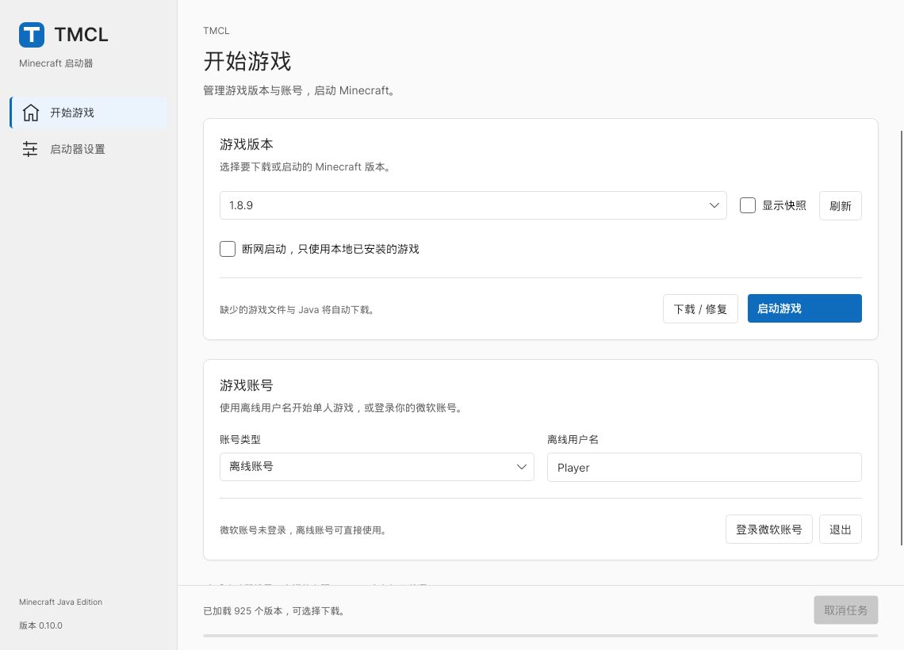

# TMCL

[下载 v0.10 正式版](https://github.com/tourio114/tmcl/releases/tag/v0.10)

提供 Fluent 2 与 Claude 暖色两种界面风格的 Minecraft Java Edition 跨平台启动器。使用 Avalonia 构建桌面界面，支持 Windows、Linux 和 macOS。默认选择 Minecraft 1.8.9，使用离线账号，微软登录可选。



## 界面与主题

Fluent 2 界面可从最新 [开发构建](https://github.com/tourio114/tmcl/actions/workflows/build.yml) 下载；已发布的 v0.10 保留原发布内容。

打开左侧 **启动器设置 → 外观**。Fluent 2 风格参考微软的 [布局](https://fluent2.microsoft.design/layout)、[形状](https://fluent2.microsoft.design/shapes) 与 [颜色](https://fluent2.microsoft.design/color) 指南，通过 Avalonia 实现：

- **界面风格**：Fluent 2（中性色层次、品牌蓝、4px 控件圆角与统一间距）或 Claude · 简约暖色（暖白 / 炭灰、陶土色、宽松留白）。
- **应用主题**：浅色、深色、跟随系统。两种界面风格均支持这三种明暗模式。
- 切换立即生效并自动保存；重启后恢复。下载任务执行中也能切换外观，旧版 PowerToys 风格及黑白主题偏好会自动迁移。其他设置可以点击页面底部的“保存设置”。

| 界面风格 | 浅色预览 | 深色预览 |
| --- | --- | --- |
| Fluent 2 | [查看](docs/fluent2-light.png) | [查看](docs/fluent2-dark.png) |
| Claude · 简约暖色 | [查看](docs/claude-light.png) | [查看](docs/claude-dark.png) |

## 功能

- 中文界面、Fluent 2 / Claude 两种风格，各支持浅色、深色、跟随系统；外观选项立即生效并自动保存。
- 正式版 / 快照列表、本地版本扫描、断网启动。
- 下载源选择：自动 / BMCLAPI / 官方。通过 IPv4 检测地区，中国默认 BMCLAPI、其他地区默认官方；测速后自动模式采用更快的源，手动选择优先。BMCLAPI 请求失败或节点超时会尝试官方源。
- 1–32 路并发文件下载，已有文件校验、SHA-1 校验、失败重试、取消任务、临时文件清理。重新下载会复用校验通过的文件；尚不支持单文件断点续传。
- 离线账号（3–16 位英文、数字、下划线），不要求微软登录。离线账号不能连接启用正版验证的服务器。
- 可选微软账号：MSAL 系统浏览器 OAuth、Xbox Live / XSTS / Minecraft 登录、启动前刷新授权、退出账号。不会收集密码，也不会把启动参数或访问令牌写入日志。
- 根据游戏元数据检测所需 Java 主版本和架构，搜索启动器缓存、`JAVA_HOME`、`PATH`。没有匹配版本时自动安装 **Eclipse Temurin OpenJDK**，校验 SHA-256、解压后运行 `java -version` 验证；也可手动指定 Java。
- 内存设置、游戏目录选择；GitHub Actions 生成六种独立运行包。

## 下载与运行

正式版本前往 [Releases](https://github.com/tourio114/tmcl/releases) 下载对应系统的 ZIP / TAR.GZ，解压后运行。

开发构建前往 [Actions](https://github.com/tourio114/tmcl/actions/workflows/build.yml)，打开最近一次成功的 **Build TMCL**，下载对应 `TMCL-*` artifact，先解开 GitHub artifact 的外层 ZIP，再解开其中的发行包。

| 系统 | 包名 | 运行方式 |
| --- | --- | --- |
| Windows x64 / ARM64 | `TMCL-win-x64` / `TMCL-win-arm64` | 解压后运行 `TMCL.exe` |
| Linux x64 / ARM64 | `TMCL-linux-x64` / `TMCL-linux-arm64` | 解开 `.tar.gz` 后运行 `./TMCL/TMCL` |
| macOS Intel / Apple Silicon | `TMCL-osx-x64` / `TMCL-osx-arm64` | 解开 `.tar.gz` 后打开 `TMCL.app` |

包自带 .NET 运行时，无需安装 .NET。Linux 需要图形桌面 / X11 或 XWayland、字体与系统图形库。Ubuntu 可安装 `libx11-6 libice6 libsm6 libfontconfig1 libfreetype6 libgl1 x11-xserver-utils`；中文显示需中文字体，例如 `fonts-noto-cjk`。安全缓存需要可用的系统钥匙串 / Secret Service；不可用时仅在内存中保留登录。

macOS 包进行临时签名，没有 Apple Developer 公证；首次打开可在系统设置中允许打开。ARM64 启动器与 Minecraft 游戏本身的 ARM64 支持不同，较老游戏版本或原生依赖可能需要 x64 启动器及操作系统模拟支持。Java 自动安装不会修改系统 `JAVA_HOME` 或 `PATH`，不需要管理员权限。

1. 保持“离线账号”，输入用户名；或按下文配置后登录微软。
2. 选择版本，点击“下载 / 修复游戏”。首次启动时自动检测并安装所需 OpenJDK。
3. 点击“启动 Minecraft”。游戏已完整安装且 Java 已就绪时，可以勾选“断网启动”。

“检测 IPv4 并测速”通过 IPv4 请求 Cloudflare trace 获取公网 IPv4 和地区，再分别读取官方与 BMCLAPI 的同一资源最多 256 KiB；测速结果包含连接耗时，只代表当时线路。自动模式首次运行以及地区缓存超过一天时检测 IPv4；手动下载源不会被自动推荐覆盖。网络变化后可重新测速。

游戏文件默认放在用户数据目录下的 `TMCL/.minecraft`；支持自行更改。界面里的 Java 路径留空即可自动管理。如果手动路径无效或版本 / 架构不匹配，会给出提示；清空即可重新启用自动管理。OpenJDK 由 Adoptium 官方 API 获取，独立于 BMCLAPI 开关。

## 可选：配置微软登录

**没有 Client ID 也可以使用离线账号和下载功能。** 仓库不内置其他启动器的应用 ID，也不需要 Client Secret。

1. 用自己的 Microsoft 账号登录 [Microsoft Entra 管理中心](https://entra.microsoft.com/)，进入“应用注册 → 新注册”。如账号无法创建目录或应用，需要先解决该账号的 Entra 租户资格。
2. 选择支持个人 Microsoft 账号的账号类型。添加“移动和桌面应用程序”平台，设置系统浏览器回调地址为 `http://localhost`，按注册页面要求启用公共客户端流程。
3. 复制“应用程序（客户端）ID”，填入 TMCL 设置的 **Microsoft OAuth Client ID**。这是公开标识，不是密码；不要填写应用密钥。
4. 参考 [Minecraft Java Edition Game Service API 申请说明](https://help.minecraft.net/hc/en-us/articles/16254801392141)申请该应用对 Minecraft 服务的访问权限；注册 Azure 应用本身不等于获得 Minecraft API 权限。
5. 点击“登录微软账号”，在系统浏览器中完成授权。账号需要拥有 Minecraft Java Edition，并满足 Xbox 账号要求。API 权限未批准、账号没有游戏或儿童账号限制时，微软登录可能无法完成。

参考：[微软桌面应用注册文档](https://learn.microsoft.com/en-us/entra/identity-platform/scenario-desktop-app-registration)、[CmlLib 的跨平台 MSAL 登录](https://cmllib.github.io/CmlLib.Core-wiki/en/auth.microsoft/cmllib.core.auth.microsoft/authentication-with-msal/)。实际账号授权必须由账号持有人操作，API 审核由微软决定。

## 本地开发与验证

安装 .NET 8 SDK 和 Python 3，然后：

```bash
dotnet restore TMCL.sln
dotnet build TMCL.sln -c Release
dotnet test tests/Tmcl.Tests -c Release
dotnet run --project src/Tmcl.App
```

按系统发布（替换 RID 为 `win-x64`、`win-arm64`、`linux-x64`、`linux-arm64`、`osx-x64`、`osx-arm64`）：

```bash
dotnet publish src/Tmcl.App -c Release -r linux-x64 --self-contained true -p:PublishTrimmed=false -o artifacts/publish
python scripts/package.py linux-x64
```

可选联网集成测试，会实际下载游戏和 OpenJDK；`--launch` 需要图形环境，会启动游戏 30 秒后关闭测试启动的进程：

```bash
dotnet run --project tools/Tmcl.Smoke -- 1.8.9 /tmp/tmcl-integration --java-only
dotnet run --project tools/Tmcl.Smoke -- 1.8.9 /tmp/tmcl-integration --launch
```

测试覆盖镜像域名转换、官方源回退、请求头保留、并发上限、损坏文件修复、校验失败不发布、取消后清理与重试，以及 Java 主版本解析和无效手动路径处理。

目前实现原版游戏安装与启动，未提供 Forge / Fabric 等模组加载器安装界面。微软真实账号端到端登录需要你自己的已授权 Client ID；自动化测试不使用真实账号。各平台构建成功不能替代各平台真实游戏运行验证。

## 技术与许可

TMCL 自有代码使用 MIT 许可。第三方库：[Avalonia](https://github.com/AvaloniaUI/Avalonia)（MIT）、[CmlLib.Core](https://github.com/CmlLib/CmlLib.Core)（MIT）、[CmlLib.Core.Auth.Microsoft](https://github.com/CmlLib/CmlLib.Core.Auth.Microsoft)（MIT）和 [MSAL.NET](https://github.com/AzureAD/microsoft-authentication-library-for-dotnet)（MIT）。自动下载的 [Temurin OpenJDK](https://adoptium.net/) 遵循其发行包内的许可证。游戏文件在用户操作后从 Mojang / BMCLAPI 下载，不包含在启动器发行包内。TMCL 与 Mojang、Microsoft、BMCLAPI 没有官方隶属关系。
